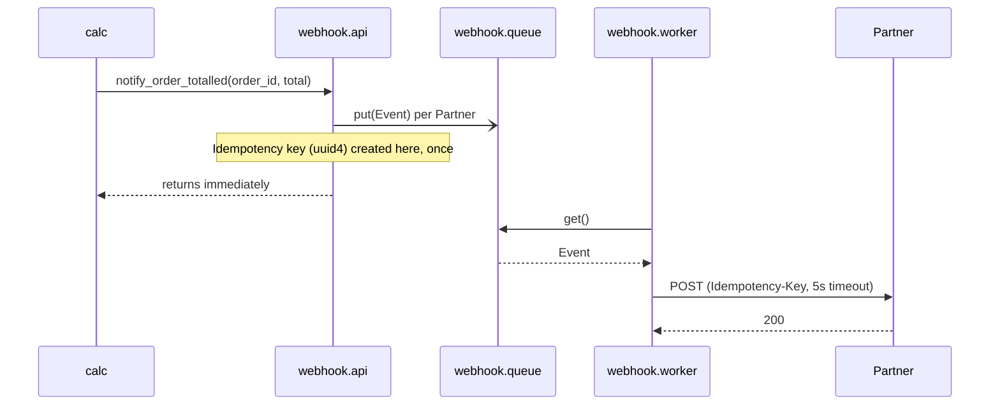
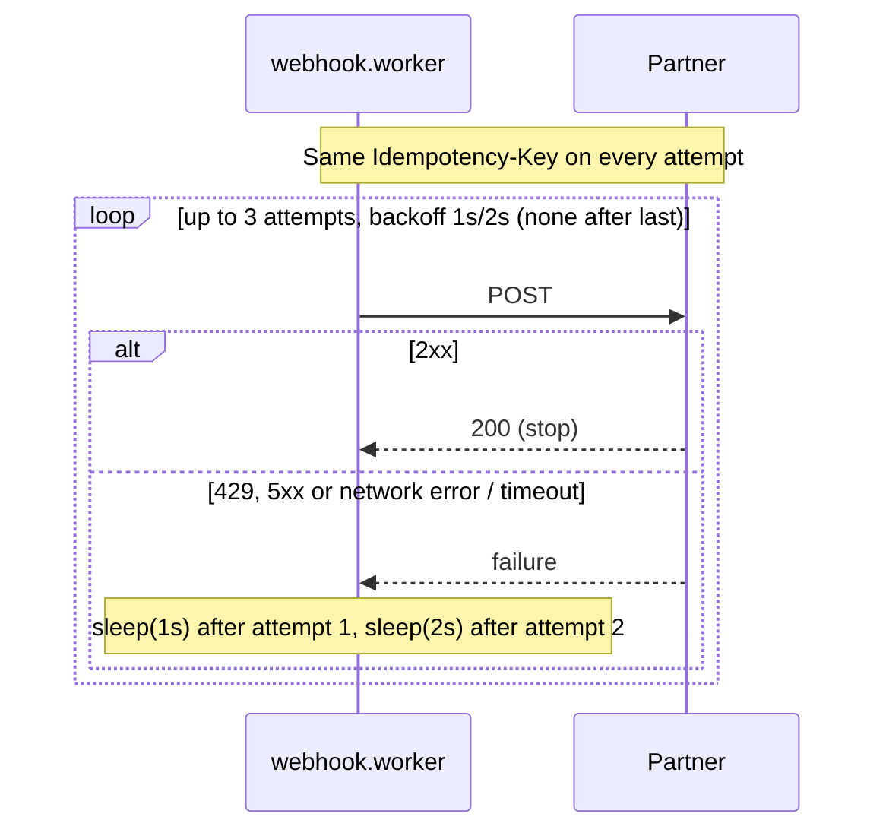
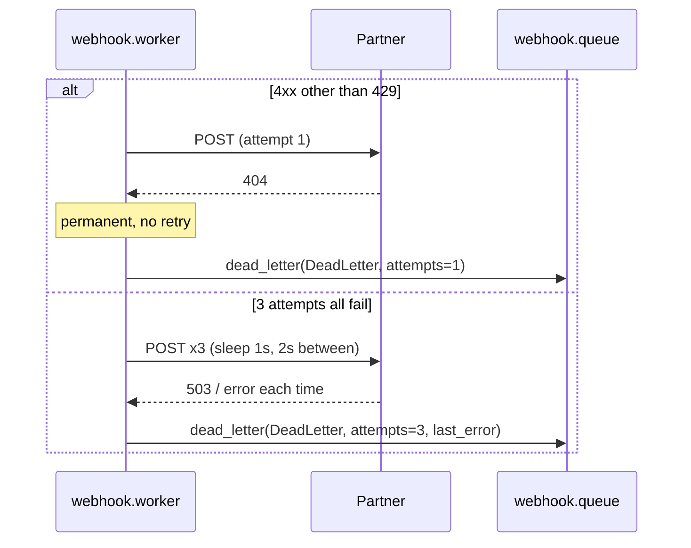

# LLD: order.totalled webhook (#6)

## 1. Summary and spec link
Partners receive a POST when an Order total is computed; delivery is asynchronous with retries and a Dead-letter list. Spec: #6. Decision on attempts and waits: [ADR 0001](../../adr/0001-three-attempts-two-waits.md).

## 2. Modules and interfaces

**`src/webhook/api.py`** - enqueue only.
```python
def register_partner(url: str) -> None          # add to the Partner list
def notify_order_totalled(order_id: str, total: float) -> None
```
`notify_order_totalled` creates one Event per registered Partner (fresh `uuid4` Idempotency key) and puts each on the module-level Event queue. It returns immediately.

**`src/webhook/queue.py`** - storage.
```python
@dataclass(frozen=True)
class Event: url: str; order_id: str; total: float; idempotency_key: str
@dataclass(frozen=True)
class DeadLetter: event: Event; attempts: int; last_error: str

class EventQueue:
    def put(self, event: Event) -> None
    def get(self) -> Event | None             # blocks; None is the stop signal
    def stop(self) -> None                    # puts the stop signal
    def dead_letter(self, entry: DeadLetter) -> None
    dead_letters: list[DeadLetter]            # read by operators
```
Wraps `queue.Queue`.

**`src/webhook/worker.py`** - delivery.
```python
def backoff_delays(max_attempts: int) -> list[float]   # 3 -> [1.0, 2.0, 4.0]; doubles from 1.0
def http_send(url: str, body: bytes, headers: dict, timeout: float) -> int  # urllib; returns status; raises OSError on network error
def deliver(event, queue, send=http_send, sleep=time.sleep, max_attempts=3) -> bool
def start_worker(queue, send=http_send, sleep=time.sleep) -> threading.Thread  # daemon; loops get() -> deliver() until None
```
Request: `POST event.url`, `Content-Type: application/json`, `Idempotency-Key: <key>`, body `{"event": "order.totalled", "order_id": ..., "total": ...}`, timeout 5.0s.

**`src/calc.py`** (changed): add `total_order(order_id, amounts) -> float` that returns `sum(amounts)` and calls `notify_order_totalled(order_id, total)`. `add` is unchanged.

## 3. Data model
`Event` and `DeadLetter` above, held in memory only. No database or file.

## 4. Error handling and retries
| Failure | Detected by | What happens |
|---|---|---|
| 2xx | status | Success; done. |
| 429, 5xx, other non-2xx non-4xx (e.g. 3xx) | status | Retry. |
| Network error or timeout | `send` raises `OSError` (timeout included) | Retry. |
| Other 4xx | 400-499 except 429 | Permanent failure: no retry, dead-letter at once. |
| 3rd attempt fails | attempt counter | Dead-letter with `last_error`. |

Retry policy: max 3 Attempts; sleep 1s after attempt 1, 2s after attempt 2; no sleep after the last. `last_error` is `"HTTP <status>"` or `repr(exception)`. The caller of `notify_order_totalled` never sees delivery errors. The Idempotency key is the same on every Attempt. A worker crash outside `deliver` is not handled (happy-path demo).

## 5. Sequence diagrams

### Happy path


### Endpoint briefly down, then recovers


### Permanent failure and exhausted retries


## 6. Testing seams
- `deliver` and `start_worker` take fake `send` and `sleep`: tests assert call counts, the sleeps `[1.0, 2.0]`, headers, and dead-letter contents. No real network or waiting.
- `backoff_delays`: pure, tested directly.
- `EventQueue` and `api`: real objects, no fakes. `api` tests read the queue to check one Event per Partner and unique keys.
- `http_send`: one test against a local `http.server` on an ephemeral port (real), covering status return and timeout/connection-refused raising.
- `calc.total_order`: patch `notify_order_totalled` and check the call.

## 7. Open questions
None.
